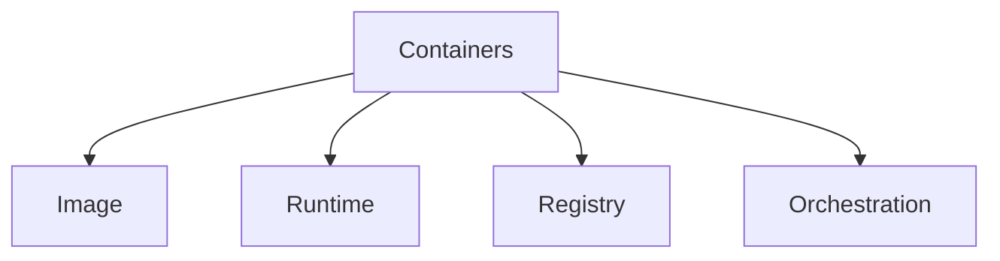
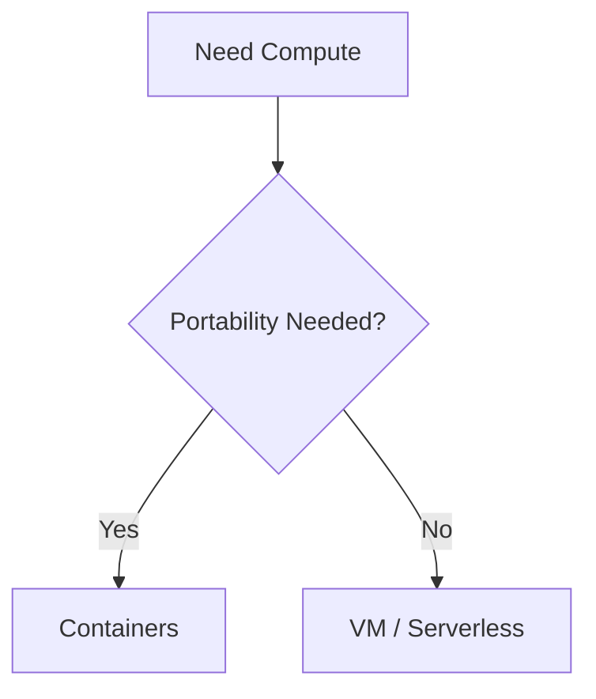
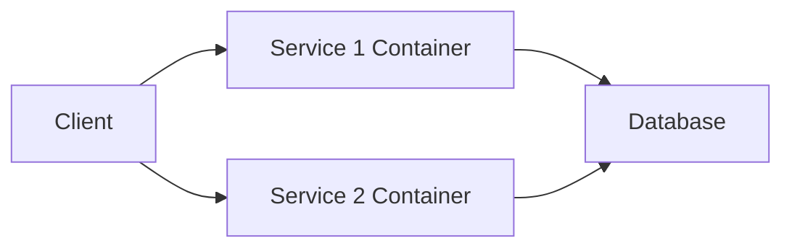

# 📦 Introduction to Containers — Deep Master

---

## 1) What are Containers?

In modern cloud platforms like Microsoft Azure, **containers** are:

> Lightweight, portable units that package an application along with its dependencies so it can run consistently anywhere

👉 Simple:

* Code + Dependencies + Runtime = Container
* “Runs the same everywhere”

---

## 2) Why do we need Containers?

Without containers:

* Works on my machine ❌
* Dependency conflicts ❌
* Environment mismatch ❌

With containers:

* Consistent environments ✔
* Easy deployment ✔
* Faster scaling ✔
* Portable apps ✔

---

## 3) When do we use Containers?

Use containers when:

* You need portability
* You want consistent environments
* You are building microservices
* You want DevOps pipelines
* You need scalable systems

---

## 4) Where are they used?

* Microservices architecture
* Cloud-native apps
* CI/CD pipelines
* Dev/test environments
* AI/ML workloads
* SaaS platforms

---

## 5) How do Containers work?

---

## 6) Real-Life Analogy

Think of containers like:

👉 **Shipping containers**

* Standard size
* Can move anywhere
* Same contents everywhere

---

## 7) Plain-English Mind Mapping

---

## 8) Engineering View

### High Cohesion

* Each container = one service

### Low Coupling

* Containers communicate via APIs

---

## Core Principle

> Build once → run anywhere

---

## 9) Types / Categories

---

### 1. Container Image

* Blueprint of container
* Built using tools like Docker

---

### 2. Container Runtime

* Runs container (Docker, containerd)

---

### 3. Container Registry

* Stores images
* Example: Azure Container Registry

---

### 4. Orchestration

* Manage multiple containers
* Example: Kubernetes

---

## 10) Advantages

* Portability
* Fast startup
* Lightweight
* Scalable
* DevOps friendly
* Isolation

---

## 11) Disadvantages

* Learning curve
* Networking complexity
* Security considerations
* Requires orchestration for scale

---

## 12) When to Choose Containers

Choose containers when:

* Building microservices
* Need portability
* Want CI/CD pipelines
* Scaling is required

---

## 13) Trade-offs

| Option     | Pros         | Cons                |
| ---------- | ------------ | ------------------- |
| VM         | Full control | Heavy               |
| Containers | Lightweight  | Needs orchestration |
| Serverless | No infra     | Limited control     |

---

---

## 14) Bad Example

❌ Installing dependencies manually on servers

---

## 15) Better Example

✅ Use container image

---

## 16) Why Better

* Consistency
* Reproducibility
* Faster deployment

---

## 17) Architecture Mapping

---

### Single Container

---

### Microservices

---

### CI/CD Flow

---

## 18) Real-World Use Cases

---

### E-commerce

* product service container

---

### Training Platform

* backend services ✔

---

### Banking

* secure microservices

---

### SaaS

* multi-tenant apps

---

## 19) Deep Concepts

---

### Container vs VM

| Feature | VM       | Container |
| ------- | -------- | --------- |
| OS      | Separate | Shared    |
| Size    | Large    | Small     |
| Startup | Slow     | Fast      |

---

### Stateless Design

Containers should be stateless

---

### Image Layers

Efficient builds

---

### Networking

Service-to-service communication

---

## 20) Common Mistakes

* storing state in containers
* large images
* ignoring security
* overusing containers

---

## 21) Best Practices

* keep images small
* use multi-stage builds
* externalize config
* secure images
* monitor containers

---

## 22) When NOT to Use

❌ Avoid when:

* simple apps
* no scaling need
* no DevOps requirement

---

## 23) Interview Definition

Containers are lightweight, portable units that package applications and dependencies together, enabling consistent execution across environments.

---

## 24) Interview Storytelling

> “I use containers to ensure consistency across environments and to build scalable microservices systems. They simplify deployment and improve DevOps workflows.”

---

## 25) MCQs

1. Container includes:
   👉 Code + Dependencies

2. Faster startup than VM:
   👉 Container

3. Registry stores:
   👉 Images

4. Orchestration tool:
   👉 Kubernetes

5. Portable means:
   👉 Runs anywhere

---

## 26) MCQ Answers

1. Code
2. Container
3. Images
4. Kubernetes
5. Anywhere

---

## 27) Subjective Questions

* What are containers?
* Difference between VM and container?
* Why use containers?

---

## 28) Assignments

* Create container image
* Push to registry
* Deploy container

---

## 29) Mini Projects

* Containerized API
* Microservices system
* CI/CD pipeline

---

## 30) Final Summary

Containers = **Portable, Lightweight Apps**

---

## 31) Memory Trick

👉 **Build → Package → Run Anywhere**

---

## 32) Beginner Rule

If portability needed → Containers

---

