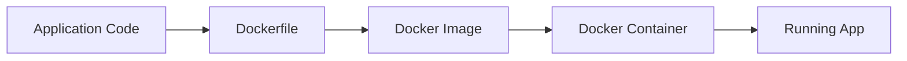
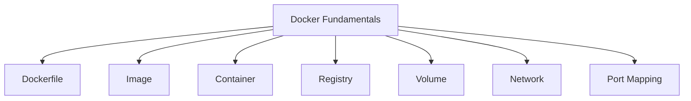
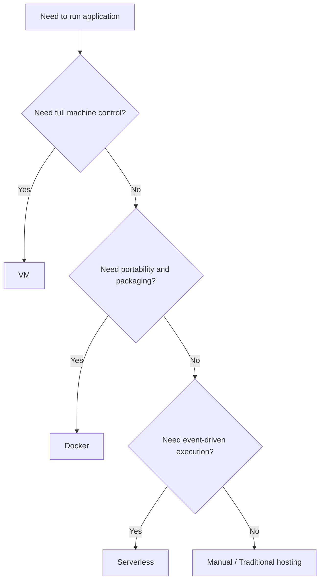
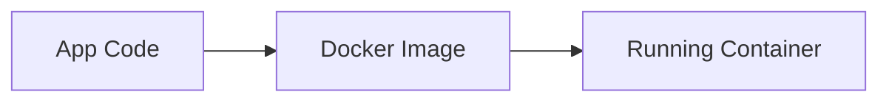
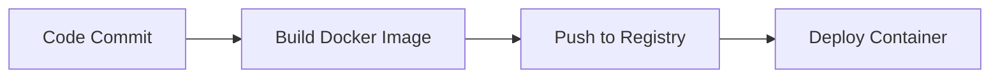
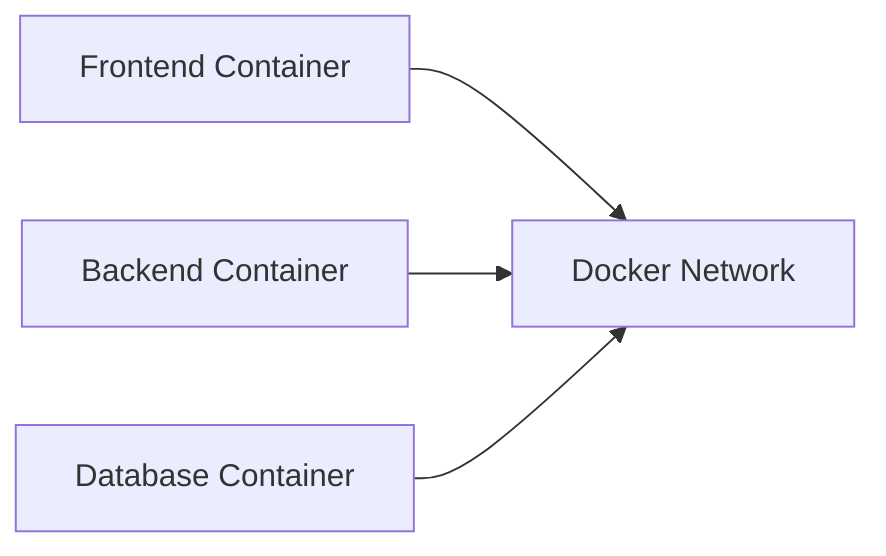

# Docker Fundamentals — Master Guide

## 0) Basic Terms

Before learning Docker, these terms must be clear.

| Term | Simple Meaning | Why It Matters |
|---|---|---|
| Docker | A platform/tool used to build, package, and run containers | Main tool you use |
| Container | A lightweight running environment for an application | Actual running app |
| Image | A packaged blueprint used to create containers | Source of container |
| Dockerfile | A text file with instructions to build an image | Build recipe |
| Registry | A storage place for Docker images | Share and deploy images |
| Docker Hub | Public registry for Docker images | Common image source |
| Volume | Persistent storage for container data | Keeps data safe |
| Network | Communication layer between containers | Connect services |
| Port Mapping | Connects container port to host machine port | Lets browser/apps access container |
| Base Image | Starting image used in Dockerfile | Foundation for your app image |
| Layer | Each Dockerfile step creates a cached layer | Improves build speed |
| Tag | A version/name for an image | Helps version control |
| .dockerignore | File to exclude unnecessary files from build | Keeps image clean |

---

## 1) What is Docker?

Docker is a container platform that helps developers package an application along with its dependencies, runtime, and configuration so that it runs consistently across environments.

In simple words:

> Docker helps you build once and run the same application anywhere.

Instead of manually installing software and dependencies on each server or developer machine, Docker packages the required environment into an image, and that image runs as a container.

---

## 2) Why do we need Docker?

Without Docker, teams commonly face these problems:

- works on one machine but fails on another
- dependency conflicts
- difficult environment setup
- slow onboarding for new developers
- inconsistent deployment process
- manual server configuration

Docker solves these by giving:

- environment consistency
- faster setup
- repeatable builds
- easier deployment
- better DevOps flow
- cleaner microservices packaging

---

## 3) When do we use Docker?

Use Docker when:

- you want consistent development and production environments
- you need faster application setup
- you are building microservices
- you want CI/CD pipelines
- you plan to deploy to cloud/container platforms
- you need reproducible builds
- you want to isolate application dependencies

---

## 4) Where is Docker used?

Docker is used in many engineering scenarios:

- local development environments
- backend APIs
- frontend applications
- microservices architectures
- CI/CD pipelines
- test automation environments
- cloud deployments
- data processing tools
- AI/ML runtime packaging

---

## 5) How does Docker work?

Docker follows a simple flow:

Application Code  
→ Dockerfile  
→ Docker Image  
→ Docker Container



### Step-by-step explanation

1. You write your application code  
2. You create a Dockerfile with build instructions  
3. Docker builds an image from the Dockerfile  
4. Docker runs that image as a container  
5. The container starts your application in an isolated environment

---

## 6) Real-Life Analogy

Think of Docker like a **food packaging system**.

- Recipe = Dockerfile
- Packed food box = Docker image
- Ready-to-eat meal = Running container

If the recipe is fixed and the packaging is fixed, then the same meal can be delivered anywhere with the same result.

That is what Docker does for software.

---

## 7) Plain-English Mind Mapping



---

## 8) Engineering View

From an engineering point of view, Docker gives:

- isolation
- repeatability
- portability
- automation-friendly packaging

### High Cohesion
A container should ideally run one focused service or one main responsibility.

### Low Coupling
Containers should communicate through clear interfaces like HTTP, queues, or databases instead of tightly depending on each other internally.

### Core Principle

> Build once, run consistently.

Docker also supports:

- immutable deployment thinking
- easier scaling in container platforms
- better separation between app and machine

---

## 9) Types / Core Components

### 1. Dockerfile
A set of instructions to build the image.

### 2. Docker Image
A packaged blueprint containing app code, dependencies, and runtime instructions.

### 3. Docker Container
A running instance of an image.

### 4. Docker Registry
A system where images are stored and pulled from.

### 5. Docker Volume
Used for persistent data storage outside the container lifecycle.

### 6. Docker Network
Used for communication between containers and external systems.

### 7. Docker Compose
A tool for running multi-container applications using a YAML file.

---

## 10) Advantages

Docker provides many benefits:

- same behavior across environments
- fast environment setup
- lightweight compared to full VMs
- easier deployment
- strong fit for DevOps pipelines
- better dependency isolation
- great fit for microservices
- simplified scaling foundation

---

## 11) Disadvantages

Docker also has trade-offs:

- learning curve for beginners
- container networking can be confusing
- security must be handled carefully
- persistent storage needs planning
- debugging multiple containers can become complex
- orchestration is needed for large-scale multi-container systems

---

## 12) When to Choose Docker

Choose Docker when:

- environment consistency is important
- your team wants reproducible deployments
- your app has dependency setup pain
- you want to prepare for cloud-native systems
- you want smoother CI/CD
- you need portable application packaging

---

## 13) Trade-offs / Comparison with Previous Options

| Option | Best For | Strength | Trade-off |
|---|---|---|---|
| Manual Setup | Very small/simple local work | Simple at first | Not repeatable |
| Virtual Machine | Full machine-level control | Strong isolation | Heavy and slower |
| Docker | App packaging and portability | Lightweight and fast | Needs container knowledge |
| Serverless | Event-driven code | Less infra work | Less runtime control |



---

## 14) Bad Example

### Manual installation on server

Imagine this process:

- install runtime manually
- install packages manually
- configure environment manually
- repeat on every machine

Problems:

- inconsistent environments
- easy to miss steps
- hard to debug
- hard to scale
- poor onboarding experience

---

## 15) Better Example

### Use Docker image

Instead of repeating setup manually:

- define setup once in Dockerfile
- build image once
- run image anywhere

This creates consistency and reduces human error.

---

## 16) Why Better

Docker-based packaging is better because:

- setup is repeatable
- environments stay consistent
- deployment becomes easier
- developer onboarding is faster
- CI/CD becomes cleaner
- rollback/versioning is easier

---

## 17) Architecture Mapping

### Single Container App



### Multi-Container App


### CI/CD Container Flow



### Docker Networking View



---

## 18) Real-World Use Cases

### Use Case 1 — Node.js API
Package the API in a Docker image so every developer and server runs the same environment.

### Use Case 2 — Frontend + Backend Stack
Use separate containers for frontend and backend for cleaner deployment.

### Use Case 3 — Test Automation Environment
Package browser automation tools and dependencies inside Docker for reproducible testing.

### Use Case 4 — Corporate Training Platform
Use containers for backend APIs, worker services, and deployment consistency.

---

## 19) Deep Concepts

### 1. Image vs Container

| Image | Container |
|---|---|
| Blueprint | Running instance |
| Static | Dynamic |
| Built once | Started/stopped multiple times |

### 2. Layers
Each Dockerfile step creates a layer.  
This helps caching and faster rebuilds.

### 3. Immutable Infrastructure Thinking
Do not manually change running containers.  
Instead, rebuild the image and redeploy.

### 4. Stateless Thinking
Containers should ideally not store important state inside themselves.  
Use databases, volumes, or external storage.

### 5. Port Mapping
Containers expose internal ports, but host systems access them through mapped ports.

Example:

```bash
docker run -p 3000:3000 my-node-app
```

This means:

- left side `3000` = host machine port
- right side `3000` = container port

### 6. Volumes
If container data should survive restarts/removal, use volumes.

### 7. Networking
Containers can talk to each other through Docker networks.

---

## 20) Common Mistakes

- putting too many services in one container
- creating very large images
- hardcoding secrets into images
- storing critical data inside container filesystem
- forgetting `.dockerignore`
- not tagging image versions properly
- not understanding difference between image and container

---

## 21) Best Practices

- keep one main responsibility per container
- use lightweight base images where possible
- use `.dockerignore`
- avoid hardcoded secrets
- use environment variables
- tag image versions properly
- use volumes for persistent data
- use multi-stage builds for cleaner images
- keep Dockerfile readable and ordered for caching

---

## 22) When NOT to Use Docker

Avoid Docker when:

- your use case is extremely tiny and local-only
- the setup overhead is greater than the problem
- your team is not ready for container workflow and the project does not need it
- a fully managed serverless solution is clearly a better fit
- the workload needs raw machine-level control more than packaging portability

---

## 23) Interview-Friendly Definition

Docker is a container platform used to package applications with their dependencies into portable images that run as containers, enabling consistent execution across development, testing, and production environments.

---

## 24) Interview Storytelling Block

> “I use Docker to remove environment mismatch problems and make deployments repeatable. Instead of manually installing dependencies on every machine, I define the application environment in a Dockerfile, build an image, and run the same container everywhere. This improves consistency, onboarding speed, and CI/CD reliability.”

---

## 25) Code Examples

## Example 1 — Simple Node.js App

### `app.js`

```javascript
const http = require("http");

const server = http.createServer((req, res) => {
  res.writeHead(200, { "Content-Type": "text/plain" });
  res.end("Hello from Docker!\n");
});

server.listen(3000, () => {
  console.log("Server is running on port 3000");
});
```

### `package.json`

```json
{
  "name": "docker-node-demo",
  "version": "1.0.0",
  "description": "Simple Node.js app for Docker fundamentals",
  "main": "app.js",
  "scripts": {
    "start": "node app.js"
  }
}
```

### `Dockerfile`

```dockerfile
FROM node:18-alpine

WORKDIR /app

COPY package.json ./

RUN npm install

COPY . .

EXPOSE 3000

CMD ["npm", "start"]
```

### Build Image

```bash
docker build -t docker-node-demo .
```

### Run Container

```bash
docker run -p 3000:3000 docker-node-demo
```

### View Running Containers

```bash
docker ps
```

### Stop Container

```bash
docker stop <container_id>
```

---

## Example 2 — Using Environment Variables

### `app.js`

```javascript
const http = require("http");

const PORT = process.env.PORT || 3000;
const MESSAGE = process.env.MESSAGE || "Default message from Docker";

const server = http.createServer((req, res) => {
  res.writeHead(200, { "Content-Type": "text/plain" });
  res.end(`${MESSAGE}\n`);
});

server.listen(PORT, () => {
  console.log(`Server is running on port ${PORT}`);
});
```

### Run with Environment Variable

```bash
docker run -p 3000:3000 -e MESSAGE="Hello from env variable" docker-node-demo
```

---

## Example 3 — Using Volume

```bash
docker volume create app-data
docker run -v app-data:/data docker-node-demo
```

---

## Example 4 — Docker Compose for Frontend + Backend

### `docker-compose.yml`

```yaml
version: "3.9"

services:
  frontend:
    image: nginx:alpine
    ports:
      - "8080:80"

  backend:
    build: .
    ports:
      - "3000:3000"
```

Run:

```bash
docker compose up
```

---

## 26) MCQ Questions

### 1. Docker image is:
A. a running process  
B. a blueprint  
C. a network  
D. a volume  

### 2. Docker container is:
A. a text file  
B. a running instance of an image  
C. a registry  
D. a command shell  

### 3. Dockerfile is used to:
A. store runtime logs  
B. define build instructions  
C. create a network only  
D. replace application code  

### 4. Registry is used to:
A. run containers only  
B. store images  
C. create Dockerfiles  
D. stop containers  

### 5. Volume is mainly used for:
A. persistent storage  
B. networking  
C. logging only  
D. image naming  

### 6. Which command builds an image?
A. docker ps  
B. docker build -t myapp .  
C. docker stop myapp  
D. docker logs myapp  

### 7. Which command runs a container with port mapping?
A. docker run -p 3000:3000 myapp  
B. docker image ls  
C. docker volume create  
D. docker inspect myapp  

### 8. A good container practice is:
A. hardcoding secrets  
B. storing database in image layer  
C. one main responsibility per container  
D. manually patching running container forever  

### 9. Docker helps mainly with:
A. environment consistency  
B. hardware replacement  
C. writing programming languages  
D. database normalization only  

### 10. Which is true?
A. image and container are the same thing  
B. container is a running instance of image  
C. Dockerfile is a running container  
D. registry is a volume  

---

## 27) MCQ Answers

1. B  
2. B  
3. B  
4. B  
5. A  
6. B  
7. A  
8. C  
9. A  
10. B  

---

## 28) Subjective Questions

1. What is Docker?
2. What is the difference between image and container?
3. Why is Docker useful in software engineering?
4. What is a Dockerfile?
5. Why are volumes needed?
6. What is the use of Docker registry?
7. Why should containers ideally be stateless?
8. What is port mapping in Docker?
9. When should you choose Docker over manual setup?
10. What are some common Docker mistakes?

---

## 29) Subjective Answers

### 1. What is Docker?
Docker is a platform used to package applications and dependencies into portable images that run as containers.

### 2. What is the difference between image and container?
An image is a blueprint, while a container is a running instance of that image.

### 3. Why is Docker useful in software engineering?
It improves consistency, deployment speed, environment setup, and CI/CD reliability.

### 4. What is a Dockerfile?
A Dockerfile is a text file containing instructions that define how a Docker image should be built.

### 5. Why are volumes needed?
Volumes are needed for persistent storage because normal container filesystem data may disappear when the container is removed.

### 6. What is the use of Docker registry?
A registry stores images so they can be shared, pulled, and deployed across environments.

### 7. Why should containers ideally be stateless?
Stateless containers are easier to scale, replace, and manage. Persistent data should usually live outside the container.

### 8. What is port mapping in Docker?
Port mapping connects a container port to a host machine port so external users or apps can access the containerized service.

### 9. When should you choose Docker over manual setup?
When you need repeatable setup, portability, clean deployment, and environment consistency.

### 10. What are some common Docker mistakes?
Large images, hardcoded secrets, bad tagging, storing important state inside containers, and mixing too many responsibilities in one container.

---

## 30) Practical Assignments

### Assignment 1 — Build First Docker App
Create:
- `app.js`
- `package.json`
- `Dockerfile`

Then:
- build image
- run container
- test in browser

### Assignment 2 — Environment Variable Demo
Modify the app to use:
- `process.env.PORT`
- `process.env.MESSAGE`

Run the container with custom environment variables.

### Assignment 3 — Volume Practice
Create a volume and attach it to a running container.

### Assignment 4 — Docker Command Practice
Practice:
- `docker build`
- `docker run`
- `docker ps`
- `docker stop`
- `docker images`
- `docker rm`

### Assignment 5 — Compose Practice
Create a simple `docker-compose.yml` with two services.

---

## 31) Mini Projects

### Project 1 — Dockerized Node.js API
Containerize a small Node.js API and run it locally.

### Project 2 — Frontend + Backend Containers
Run a frontend service and backend API using Docker Compose.

### Project 3 — Static Site with Nginx
Package a static HTML/CSS site using Nginx Docker image.

### Project 4 — Training Platform Service Packaging
Create container strategy for:
- backend API
- worker service
- frontend app

---

## 32) Final Summary

Docker helps package applications into portable containers so they run consistently across environments.

### Main memory points

- Dockerfile = recipe
- Image = blueprint
- Container = running instance
- Registry = image storage
- Volume = persistent data
- Network = service communication

### Why Docker matters

- consistency
- portability
- repeatable builds
- easier deployment
- DevOps readiness

---

## 33) Memory Trick

Think like this:

**Dockerfile → Image → Container**

And remember:

**Build once → run anywhere**

---

## 34) Beginner Rule

Ask these questions:

- Is setup inconsistent across machines?
- Do I want repeatable deployment?
- Do I need app portability?
- Do I want cleaner CI/CD?

If yes, Docker is often a strong choice.
